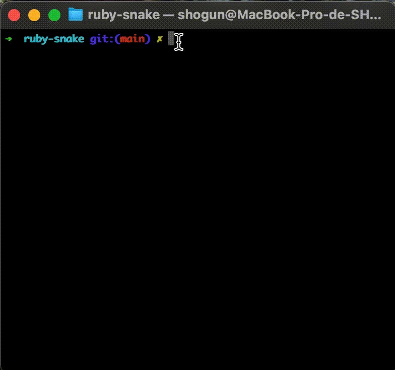

# ruby-snake

A terminal Snake game in pure Ruby, with no gems at runtime. I built it step by step, test-first with RSpec, to practice Ruby and object-oriented design.

## Run it

Requires Ruby 3+ (check with `ruby -v`).

    git clone https://github.com/ShogunKaims/ruby-snake.git
    cd ruby-snake
    ruby bin/snake

## Controls

| Key | Action |
|-----|--------|
| `I` or ↑ | up |
| `K` or ↓ | down |
| `J` or ← | left |
| `L` or → | right |
| `Q` | quit |

## Game modes

When the game starts, a menu lets you pick a mode:

| Key | Mode | Rules |
|-----|------|-------|
| `1` | **Original** | Leaving the board, or biting yourself, ends the game. |
| `2` | **Chill** | The snake wraps around the edges: leave on the right and you come back on the left. Only biting yourself ends the game. |

Eat the 🍎 to grow and score points.

## After a game over

When the game ends, a menu appears:

| Key | Action |
|-----|--------|
| `R` | Replay in the same mode |
| `M` | Go back to the menu and change mode |
| `Q` | Quit |

## Tests

    gem install rspec
    rspec

## Design

| File | Role |
|------|------|
| `lib/snake.rb` | Snake state: body, direction, movement, growth, self-collision |
| `lib/food.rb` | Food placement, never on top of the snake |
| `lib/board.rb` | Grid bounds, wrap-around and themed text rendering |
| `lib/game.rb` | Rules of one turn (`tick`) in two modes (classic, chill): move, eat, score, game over |
| `bin/snake` | Terminal UI: start menu, game loop, raw keyboard input, game over menu |
| `lib/ui.rb` | Terminal decoration: colors, boxes, title and game over screens (pure text, unit-tested) |
The game logic never touches the terminal, so every rule is unit-tested. Only `bin/snake` deals with input and screen.

## License

MIT
